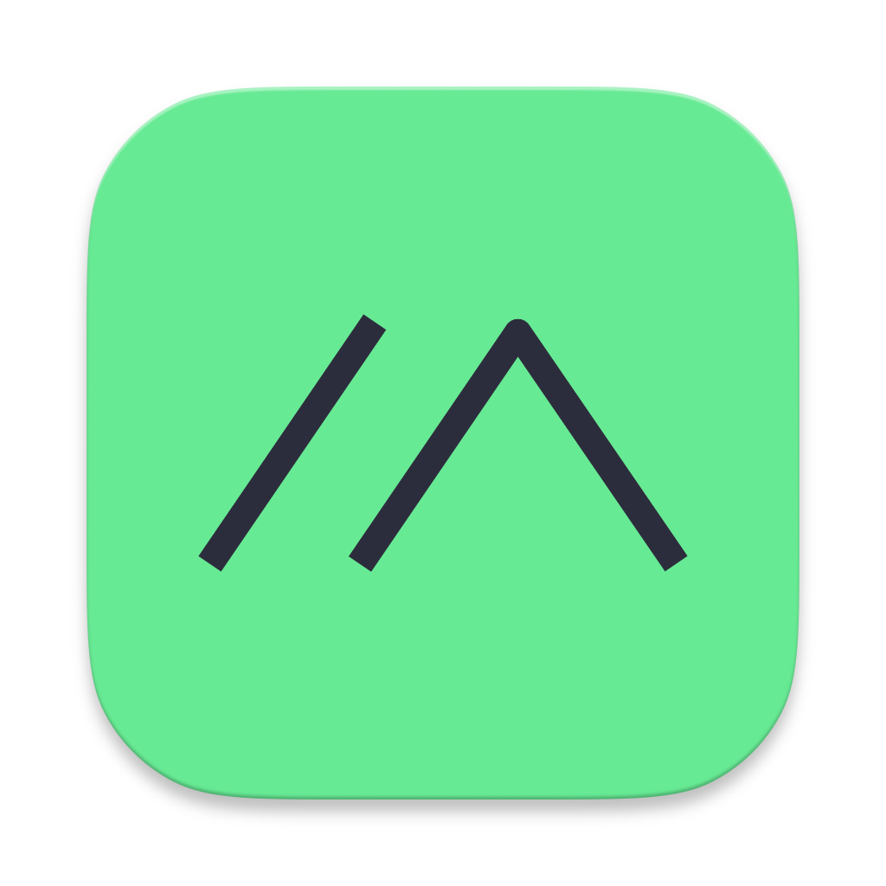

# Meshtastic-Android: Ultra-Low-Bitrate 24kHz Neural Audio (WavTokenizer) & Tactical Live PTT over LoRa

<p align="center">
  
</p>

<p align="center">
  <a href="https://github.com/Mohammask/Meshtastic-Android-NeuralAudio/releases"></a>
  
  
  
</p>

---

> [!WARNING]
> ### ⚠️ Experimental Solo Research Pre-Release (Alpha) — Proof of Concept
> This repository is an independent research prototype developed by a solo developer for experimental exploration. It demonstrates the technical feasibility of real-time ultra-low-bitrate 24kHz wideband neural voice transmission and tactical half-duplex Push-To-Talk (PTT) over raw sub-GHz LoRa physical layers without custom firmware.
> **Please note:** This project is under active development, contains known bugs and limitations, and is provided "AS IS" without warranties or formal SLAs. Community feedback, testing, and bug reports are warmly welcome!

> [!IMPORTANT]
> ### ⚡ Zero Firmware Modification Required!
> **Runs on 100% stock Meshtastic firmware** (ESP32, nRF52, RP2040, STM32) across standard radio nodes (Heltec V3, LilyGO T-Beam, RAK Meshtastic Starter Kit, Seeed SenseCAP, Station G2).
> All neural compression, multi-chunk micro-framing, Selective-Repeat ARQ, floor arbitration, and jitter buffer scheduling execute purely on-device in the Android application runtime over standard Meshtastic `PortNum.PRIVATE_APP` (port 256). **Participating nodes only need to install this Android APK.**

> [!CAUTION]
> ### 🌐 Good Mesh Citizen Etiquette: Dedicated & Private Channels ONLY!
> **Please be a considerate mesh citizen: DO NOT broadcast voice notes or Live PTT over shared public primary channels (e.g., city-wide `LongFast` / Channel 0).**
> Transmitting continuous voice payloads over congested public community meshes will degrade airtime for standard text messaging across your town.
> 
> **Recommended Best Practices for Voice Testing:**
> 1. **Use Private Channels:** Conduct all voice testing on dedicated private secondary channels with a pre-shared key (PSK) or a dedicated frequency slot.
> 2. **Use Fast Modem Presets:** Configure your private channel for **`ShortFast`** or **`MediumFast`** modem presets. This slashes Time-on-Air (ToA) per packet by 3x–5x compared to LongFast.
> 3. **Restrict Hop Limits:** Keep `hop_limit` set to `1` (direct P2P line-of-sight) or `2` for local team testing. Avoid setting high hop limits that cause voice packets to propagate across regional public relay nodes.
> 4. **Respect Duty Cycle Caps:** In regions with strict regulatory transmission caps (e.g., EU 868 MHz 1% or 10% duty cycle), keep voice notes short and infrequent.

---

## 1. Executive Overview: Breaking the LoRa Voice Barrier

Historically, digital voice transmission over sub-GHz LoRa (Semtech SX1262 / SX1276) was deemed practically impossible. Traditional sub-GHz LoRa modulation trades data rate for extreme link budget and range:
- Standard channels offer net physical throughput ranging from **~1,000 bps to 5,500 bps** (e.g., Short/Fast vs. Long/Fast modem presets).
- Standard cellular speech codecs (AMR, Opus, AAC) demand **6,000 bps to 32,000+ bps**—orders of magnitude higher than LoRa's Shannon capacity limit.
- Legacy low-bitrate military vocoders (MELP/MELPe at 2400 bps, Codec 2 at 700–1400 bps) achieve intelligibility but suffer from synthetic "robotic" timbre, loss of speaker inflection, and acoustic fragility under background noise.

This research fork breaks the voice barrier by converging **state-of-the-art neural speech tokenization** with an **asynchronous micro-packet transport protocol**:

```
[24kHz 16-bit Mono PCM]
          │
          ▼
┌─────────────────────────────────┐
│ WavTokenizer ONNX Vocoder       │  75 Quantizer Tokens/sec
│ (12 bits/token = ~900 bps)      │  112.5 bytes/sec payload
└────────────────┬────────────────┘
                 │
                 ▼
┌─────────────────────────────────┐
│ 3-Byte Micro-Framing Protocol   │  MTU-Optimized Headers (≤ 205 bytes/chunk)
│ (ChunkingEngine)                │  3-Byte Token Alignment & Live-Flag Tagging
└────────────────┬────────────────┘
                 │
                 ▼
┌─────────────────────────────────┐
│ LoRa Transport & Selective ARQ  │  Adaptive Time-on-Air (ToA) Dispatch Pacing
│ (ReassemblyBuffer & NACK Engine)│  Selective Repeat NACK + Packet Loss Concealment
└────────────────┬────────────────┘
                 │
                 ▼
[Stock Meshtastic Radio via BLE / USB / TCP]
```

By compressing continuous 24,000 Hz human speech into 75 discrete vector-quantized tokens per second (12 bits per token), the raw speech information rate drops to **900 bps (112.5 bytes/second)**. A 5-second wideband voice note is represented in only **562 bytes**—fitting neatly within three LoRa packets.

---

## 2. Core Architectural Innovations

### A. On-Device 24kHz Neural Vocoder (`WavTokenizerEngine`)

Speech compression and synthesis are performed entirely offline using an optimized ONNX Runtime Mobile execution engine calibrated for low-latency mobile inference.

| Parameter | WavTokenizer Neural Mode | Codec 2 Fallback Mode |
|---|---|---|
| **Audio Sample Rate** | **24,000 Hz** (Mono Float32 PCM) | **8,000 Hz** (Mono Short PCM) |
| **Acoustic Quality** | **Wideband Studio Fidelity** | Ultra-Narrowband Simplex Voice |
| **Token Rate** | **75 tokens / second** | 50 frames / second |
| **Quantization Resolution**| **12 bits / token** ($2^{12} = 4096$ codebook entries)| Bit-packed parametric spectral lines |
| **Gross Bitrate** | **~900 bps** (112.5 B/s) | **700 bps (700C) / 1400 bps (1400)** |
| **Runtime Engine** | ONNX Runtime Mobile (`encoder_int8.onnx` + `model_int8.onnx`) | Embedded native C/C++ (`libcodec2.so`) |
| **Hardware DSP** | `AudioDspUtils`: Software AGC, High-pass filter, Dynamic Normalization | Native pre-emphasis / energy shaping |
| **Network Requirements**| **100% Offline** (Zero cloud calls, zero external downloads) | **100% Offline** |

### B. 3-Byte Micro-Framing Protocol (`ChunkingEngine`)

To maximize usable throughput over LoRa's strict ~237-byte Maximum Transmission Unit (MTU), the transport layer eschews heavy protobuf wrappers in favor of a lean, 3-byte binary micro-header:

```
 0                   1                   2       
 0 1 2 3 4 5 6 7 8 9 0 1 2 3 4 5 6 7 8 9 0 1 2 3 
+-+-+-+-+-+-+-+-+-+-+-+-+-+-+-+-+-+-+-+-+-+-+-+-+
|   Msg_ID (1B) |Typ(4b)|Tot_Chk(4b)|L| Chk_Idx(7b) |
+-+-+-+-+-+-+-+-+-+-+-+-+-+-+-+-+-+-+-+-+-+-+-+-+
|                 Payload Data...               |
|            (up to 205 bytes per chunk)        |
+-+-+-+-+-+-+-+-+-+-+-+-+-+-+-+-+-+-+-+-+-+-+-+-+
```

1. **Byte 0 — `Msg_ID` (8 bits)**: Rotating session/message transaction identifier ($0\dots255$) providing disambiguation across concurrent or back-to-back transmissions.
2. **Byte 1 — `Type + Total_Chunks` (8 bits)**:
   - High 4 bits: Payload MIME descriptor (`0x10` = Codec 2, `0x30` = PTT Control Signaling, `0x50` = WavTokenizer 24kHz).
   - Low 4 bits: Total chunk count ($1\dots16$).
3. **Byte 2 — `LiveFlag + Chunk_Index` (8 bits)**:
   - **Bit 7 (`LiveFlag`)**: `0` = Persistent Voice Note, `1` = Ephemeral Tactical Live PTT frame (`LIVE_PTT_INDEX_FLAG = 0x80`).
   - **Bits 0–6 (`Chunk_Index`)**: Zero-based segment sequence index ($0\dots N-1$).

> [!NOTE]
> **Strict 3-Byte Token Alignment**: WavTokenizer 12-bit tokens pack two tokens into exactly 3 bytes ($2 \times 12\text{ bits} = 24\text{ bits} = 3\text{ bytes}$). The chunking engine enforces payload chunk sizes that are integer multiples of 3 bytes (typically 204 bytes = 136 tokens per packet), eliminating inter-packet token fragmentation.

### C. Bitmask Reassembly, Selective Repeat NACK & Packet Loss Concealment (`ReassemblyBuffer`)

LoRa channels suffer from localized fading, interference, and packet drops. Rather than retransmitting entire voice notes or corrupting the decoder pipeline, the reassembly buffer implements bounded, loss-resilient reconstruction:

- **16-Bit Bitmask Session Tracking**: Every active session tracks received chunks using an unsigned 16-bit bitmask (`bitmask |= (1 shl chunkIndex)`).
- **Multi-Round Selective NACK**: If the final chunk arrives or an inter-frame timeout expires with missing slots, the receiver emits a tiny 3-byte Selective NACK back to the transmitter:
  ```
  [Msg_ID (1B) | Missing_Mask_Low (1B) | Missing_Mask_High (1B)]
  ```
  The transmitter inspects its ring buffer and re-dispatches *only* the specific missing chunks requested, conserving channel airtime.
- **Tombstone Deduplication**: Successfully assembled and played transmissions are logged in a 30-second rotating tombstone cache, ensuring retransmitted trailing packets cannot re-trigger stale audio playback.
- **Graceful Packet Loss Concealment (PLC)**: If radio retries are exhausted and missing chunks cannot be recovered, `ReassemblyBuffer.assembleWithPlc()` automatically synthesizes 12-bit-aligned zero-amplitude acoustic padding tokens. The ONNX neural vocoder smoothly interpolates through the concealed gap without crashing or generating harsh audio clipping.

### D. Adaptive Time-on-Air (ToA) Radio Pacing (`PayloadAnalyzer`)

Spamming back-to-back packets into the radio over BLE or USB saturates transceiver buffers and causes packet loss due to half-duplex self-interference.
`PayloadAnalyzer` calculates the physical Time-on-Air (ToA) of each packet based on the active LoRa modem configuration:
$$\text{ToA} = \text{Preamble Duration} + \text{Payload Symbol Count} \times T_s$$
Inter-chunk dispatches are paced with an adaptive safety backoff ($T_{\text{delay}} = \text{ToA} \times 1.15 + \Delta_{\text{guard}}$), maintaining radio buffer stability without overflow.

### E. Tactical Ephemeral Live Walkie-Talkie (`LivePttSessionManager` & `LivePttCallScreen`)

For time-critical field tactical comms, the fork provides an ephemeral Live PTT streaming mode that operates like an open simplex walkie-talkie channel:

- **Strictly RAM-Only Ephemeral Flow**: Live voice packets bypass SQLite/Room storage entirely. No audio files or message records are written to disk, preventing flash degradation and preserving tactical privacy.
- **Micro-Packet Floor Arbitration**: Floor control is managed via signaling micro-packets:
  - `OPCODE_FLOOR_REQ` (`0x11`): Transmitter keys mic and requests the floor.
  - `OPCODE_FLOOR_REL` (`0x12`): Transmitter releases PTT key.
  - `OPCODE_PTT_JOIN` (`0x13`): Peer joins live PTT room.
  - `OPCODE_PTT_HERE` (`0x14`): Presence announcement response.
  - `OPCODE_PTT_LEAVE` (`0x15`): Peer leaves live PTT room.
  - `OPCODE_PTT_DONE` (`0x16`): Receiver acoustic speaker-drain acknowledgment.
- **Hardware AudioTrack Head Drain Verification**: When a transmission concludes, the receiver does not immediately release the channel lock. It polls the Android HAL `AudioTrack.playbackHeadPosition` to verify that all buffered audio has physically exited the speaker before resetting the receiver floor state, preventing key-up truncation.
- **Deterministic Unsigned 32-bit `Node_ID` Tie-Breaking**: If two nodes transmit `OPCODE_FLOOR_REQ` simultaneously, the node with the numerically higher unsigned 32-bit Node ID wins the floor; the lower node yields gracefully to avoid a transmission collision deadlock.

---

## 3. Physical Realities & Half-Duplex Operational Limitations

> [!CAUTION]
> ### 📡 Understand the Physics of Sub-GHz LoRa
> This software is an **experimental research proof of concept**. It is subject to the fundamental physical constraints of sub-GHz half-duplex radio transceivers:

1. **Simplex / Half-Duplex Radios**: LoRa transceivers (Semtech SX1262, SX1268, SX1276) cannot transmit and receive simultaneously on the same frequency. If your radio is actively transmitting, it is 100% blind to incoming signals.
2. **Time-on-Air (ToA) Propagation Latency**: Depending on the channel preset (e.g., Short/Fast vs. Medium/Fast vs. Long/Fast), transmitting a 200-byte packet takes anywhere from **300ms to 1,500ms+**.
3. **Bluetooth/BLE Queuing Jitter**: Android-to-node BLE transfers introduce variable queue buffering delays (50ms–200ms).
4. **Simultaneous Keying Collisions**: If two operators press PTT at the exact same fraction of a second—before the remote `FLOOR_REQ` packet has cleared the airwaves—an RF collision occurs, and one or both nodes will experience a delayed lock transition or lost packet.
5. **Radio Discipline Required**: Operators must practice standard simplex radio discipline:
   - **Listen before talking**: Check that the channel is clear and the UI indicates an idle channel before pressing PTT.
   - **Hold PTT firmly**: Speak clearly after pressing the PTT control, and release when finished.
   - **Allow turnaround time**: Wait 1–2 seconds between transmissions to allow remote nodes to acknowledge or drain speaker buffers.
6. **Channel Choice & Community Consideration**: Never transmit audio experiments on shared public channels (Channel 0 / `LongFast`). Always switch to a dedicated private secondary channel with a low hop limit (`hop_limit = 1` or `2`) and faster modulation (`ShortFast` or `MediumFast`).

---

## 4. Open Challenges & Call for Contributors (`Help Wanted`)

We warmly invite embedded communications architects, digital signal processing engineers, and Android HAL audio developers to collaborate:

- [ ] **CAD (Channel Activity Detection) Integration**: Tighter coupling with firmware CAD interrupts to automatically abort outbound transmission if preamble energy is detected on-frequency.
- [ ] **Adaptive Jitter Buffer & PLC**: Dynamic jitter buffer sizing based on real-time RSSI/SNR variance.
- [ ] **Hardware PTT Button Support**: Integration with physical PTT buttons on rugged Android devices (Runbo, Sonim, Ulefone, Inrico).
- [ ] **Cross-Vendor Hardware Validation**: Comprehensive RF testing on diverse transceiver hardware (RAK Wireless, Heltec, TTGO T-Beam, Station G2, Nomad Star).

---

## 5. Quick Start & Installation Guide

### Step 1: Download the Pre-Release APK
Download the latest pre-built APK from the [GitHub Releases](https://github.com/Mohammask/Meshtastic-Android-NeuralAudio/releases) page:
- **`Meshtastic-NeuralAudio-fdroid-debug.apk`**: Full debugging logs, LeakCanary memory profiling, and development diagnostics.
- **`Meshtastic-NeuralAudio-fdroid-release.apk`**: Optimized build, stripped binaries, signed with default key for immediate sideloading.

### Step 2: Connect to Your Stock Meshtastic Node
1. Enable Bluetooth on your Android device.
2. Pair with any stock Meshtastic node running standard firmware (v2.5.0 or newer).
3. Open the app and verify the node connects normally.

### Step 3: Configure Audio Codec
1. Navigate to **Settings** → **App Preferences**.
2. Under **Audio Codec Selection**, choose:
   - **`WavTokenizer (24 kHz Neural Vocoder)`** *(Recommended for modern ARM64 devices)*
   - **`Codec 2 (700C / 1400 bps)`** *(Recommended for legacy or resource-constrained devices)*

### Step 4: Transmit Voice & Live PTT
- **Asynchronous Voice Note**: In any Direct Message or Channel, **press and hold** the microphone icon (`🎙️`). Speak your message (up to 30 seconds), then **release to send** (or slide left to cancel).
- **Tactical Live PTT**: Tap **`📻 Walkie-Talkie`** in the action bar to enter the real-time PTT call screen. Press and hold **`PUSH TO TALK`** while observing channel floor arbitration status.

---

## 6. Building from Source

### Prerequisites
- JDK 17 or JDK 21
- Android SDK Platform 35 & NDK 27+
- CMake 3.22.1+

### Build Commands

```bash
# Clone the repository
git clone https://github.com/Mohammask/Meshtastic-Android-NeuralAudio.git
cd Meshtastic-Android-NeuralAudio

# Run unit tests across core media and protocol modules
./gradlew :core:model:jvmTest :core:data:jvmTest :core:repository:jvmTest :feature:messaging:jvmTest

# Assemble F-Droid Debug and Release APKs
./gradlew :androidApp:assembleFdroidDebug :androidApp:assembleFdroidRelease
```

> [!NOTE]
> Pre-built Release APKs have the WavTokenizer ONNX neural models (`encoder_int8.onnx` and `model_int8.onnx`) 100% bundled inside. When building from source without Git LFS, ensure both model files are placed in `androidApp/src/main/assets/ai-model/` (downloadable from the [GitHub Releases](https://github.com/Mohammask/Meshtastic-Android-NeuralAudio/releases) page).

Compiled APK artifacts are located in:
`androidApp/build/outputs/apk/fdroid/debug/` and `androidApp/build/outputs/apk/fdroid/release/`.

---

## 7. License & Acknowledgments

- **Meshtastic-Android Neural Audio Fork**: Modifications Copyright © 2026 Mohammask. Licensed under the **[GNU General Public License v3.0 (GPLv3)](LICENSE)**.
- **Upstream Meshtastic-Android**: Licensed under the **[GNU General Public License v3.0 (GPLv3)](LICENSE)**. Copyright © 2020–2026 Meshtastic LLC and contributors.
- **WavTokenizer**: Developed by Shengpeng Ji et al. (Zhejiang University & Ant Group), licensed under [Apache 2.0 / MIT](https://github.com/jishengpeng/WavTokenizer). Reference: *"WavTokenizer: an Efficient Acoustic Discrete Codec Tokenizer with Extreme Low Bitrate"* ([arXiv:2408.16532](https://arxiv.org/abs/2408.16532)).
- **Codec 2**: Developed by David Rowe and contributors, licensed under [LGPL v2.1](https://www.gnu.org/licenses/old-licenses/lgpl-2.1.html).
- **ONNX Runtime Mobile**: Developed by Microsoft Corporation, licensed under the [MIT License](https://github.com/microsoft/onnxruntime).
- **AOSP / Android Jetpack**: Copyright © Google LLC, licensed under [Apache 2.0](https://www.apache.org/licenses/LICENSE-2.0).

For comprehensive third-party legal notices, intellectual property declarations, and academic citations, please see **[NOTICE.md](NOTICE.md)**.


